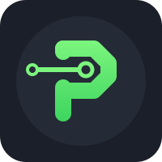

<div align="center">



# Proxias

[](https://github.com/Morebec/proxias/actions/workflows/ci.yml)
[](https://pkg.go.dev/github.com/morebec/proxias)

[](LICENSE)

</div>

A Go SDK to develop AI agents easily. It orchestrates: it runs an agent's turns, executes the actions it asks for, keeps
the trace of what happened, and streams it. Everything else is an extension point (how the agent thinks, what it can
do, what it remembers, which model it runs on), and the SDK ships batteries for each.

Use it for:

- **chat apps:** a person talks to an agent, turn by turn;
- **headless harnesses:** agents that run unattended, reacting to events (alerts, probes, webhooks) with `Agent.Watch`;
- **multi-agent apps:** the app orchestrates; an agent talks to another through an action of the app's;
- **serving an agent:** as an OpenAI-compatible model, over Agent Protocol, or over plain HTTP.

## Quick start

```go
package main

import (
	"context"
	"fmt"
	"time"

	"github.com/anthropics/anthropic-sdk-go"

	"github.com/morebec/proxias"
	agentanthropic "github.com/morebec/proxias/adapters/anthropic"
)

func main() {
	agent := &proxias.Agent{
		ID:           "ada",
		AgentPersona: proxias.AgentPersona{Name: "Ada", Role: "assistant"},
		ActionExecutor: proxias.SimpleActionExecutor{Actions: map[string]proxias.SimpleAction{
			"get_time": {
				ActionDescriptor: proxias.ActionDescriptor{ID: "get_time", Description: "Tells the current time."},
				RunFn: func(context.Context, proxias.Session, map[string]any) (proxias.ActionExecutionResult, error) {
					now := time.Now().Format(time.RFC3339)
					return proxias.ActionExecutionResult{ActionID: "get_time", Status: "completed", Data: map[string]any{"now": now}}, nil
				},
			},
		}},
	}
	llm := agentanthropic.NewLLM(anthropic.NewClient(), "claude-haiku-5-5") // its key: ANTHROPIC_API_KEY
	session := proxias.NewSession(proxias.NewMessageEvent(proxias.NewUserSource("john"), "What time is it?"))

	// Loop takes turns until the agent is done: here, a call of get_time, then the reply.
	stream, err := agent.Loop(context.Background(), session, proxias.NewReActStrategy(llm))
	if err != nil {
		panic(err)
	}
	session, err = stream.Collect() // or range over stream.Updates() for the events and chunks as they come
	if err != nil {
		panic(err)
	}
	fmt.Println(session.LastEvent().Text())
}
```

## Concepts

- **Agent:** who it is (`AgentPersona`, `Biases`), what it can do (`ActionExecutor`), what it remembers (`Memory`), and
  what wraps each of its turns (`Middleware`). It holds no session: one agent serves any number of them.
- **Session and events:** a session is the immutable trace of an agent's experience, a list of `Event`s: messages from
  people, agents and systems, thoughts, action requests and their results, anything the app appends. The app keeps it.
- **Invoke, Loop, Watch:** `Invoke` takes one turn; `Loop` takes turns until the strategy says the agent is done
  (`StopReasonEndTurn`) or it took `DefaultMaxTurns` (`StopReasonMaxTurns`, not an error); `Watch` loops on each event of
  a channel. Each returns a `SessionStream`: the updates as they come (whole events, chunks of text), and the session.
- **CognitiveStrategy:** how the agent thinks, one turn at a time, given an `Invocation` (the agent, its session, its
  memories). It asks the model, has the agent's `ActionExecutor` run the actions it decides on, and says when the agent
  is done. Write your own, or wrap one with an `AgentMiddleware`.
- **ActionExecutor:** the agent's execution layer: the actions it describes (`ActionDescriptor`, with a JSON Schema of
  their parameters), and their execution. A failed action is a result the model sees, not an error.
- **MemoryProvider:** the agent's memory beyond a session, which the agent curates itself. `Invoke` gives each turn
  what it recalls (`Invocation.Memories`), offers the actions it is curated with (its `ActionExecutor`) next to the
  agent's, and has it memorize what the turn added. Whose memory it is, is the provider's call: from the session, it
  can tell whom the agent deals with, and keep a memory per person next to a shared one. Message history is not
  memory: it is the session, which the app keeps.
- **LLM and System1Model:** the two model interfaces the strategies use. An `LLM` answers a request (`LLMRequest`, built
  from a session with `NewLLMRequestFromSession`) with text, thinking and tool calls. A `System1Model` answers questions
  about a state with calibrated probabilities (a choice, a score, a noul), as a fast discriminative model does.

## Batteries included

- **Strategies** (see [docs/strategies.md](docs/strategies.md)):
  - `NewReActStrategy` ([ReAct](docs/strategies/react.md)): one model call a turn, every action a tool.
  - `NewReWOOStrategy` ([ReWOO](docs/strategies/rewoo.md)): the model plans the whole task, the agent runs the
    plan, and the model answers from what it found: two calls a turn.
  - `NewGatedStrategy`, Proxias' flow: an `ActionClassifier` finds the actions the last message asks for, the agent runs
    them, and one call writes the reply. When it asks for none, the turn is the reasoning strategy's (ReAct, say).
- **Classifiers:**
  - `LLMActionClassifier`, in a single call;
  - `CompositeActionClassifier`, an `ActionSelector` then an `ActionParameterExtractor`, to mix and match:
    `LLMActionSelector` or `System1ActionSelector`, then `LLMActionParameterExtractor`.
- **Prompts:** every prompt is a field of what uses it, its default an exported constant to use or extend
  (`DefaultReActPrompt`, `DefaultLLMClassificationPrompt`, `DefaultLLMSelectionPrompt`, `DefaultLLMExtractionPrompt`,
  `DefaultSynthesisPrompt`, and `adapters.DefaultChoicePrompt`...).
- **Models:**
  - `adapters/anthropic` (Claude: thinking, caching, usage counting);
  - `adapters/openai` (Chat Completions);
  - `adapters.LLMSystem1`, an LLM as a `System1Model`.
- **Transports:**
  - `transports/agenthttp`: an agent over HTTP, its updates streamed;
  - `transports/openaihttp`: agents as models of an OpenAI-compatible Chat Completions API;
  - `transports/agentprotocolhttp`: an agent over Agent Protocol.
- **Memory:** `MarkdownMemory`, a MEMORY.md the agent curates: told whole at every turn, rewritten with its
  `update_memory` action. Any other kind (per person, retrieval...) is a `MemoryProvider` of the app's.
- **Actions:** `SimpleActionExecutor`, actions as Go functions.

## Examples

- `examples/agent-cli`: a chat in the terminal with an agent that reads and writes files, runs bash, and curates its
  memory (a `MarkdownMemory`) across runs.
- `examples/agentdemo`: the shared setup of the examples, and their scripted models: `agent-chat`, `agent-team`
  (agents that delegate to each other) and `agent-unattended` (a headless agent on probe events) run on it, without a
  key.
- `examples/agentbench`: compares the strategies on scenarios, on scripts or on Claude: success, calls, tokens, cost,
  time.

## Design principles

- **The SDK orchestrates; it never compensates for the model.** What the model sees is the session as it is; what it
  answers is acted on as it is. Judgment is the model's.
- **Vendor quirks live in the adapters.** What a vendor's API refuses or requires is that adapter's concern, not the
  strategies'.
- **The loop is outside the strategy.** A strategy takes one turn; `Loop` and `Watch` decide when to take another.
- **Everything is replaceable.** Strategies, classifiers, prompts, executors, memory and models are interfaces or
  fields, with defaults.
