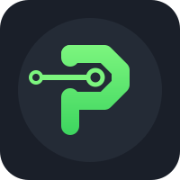

<p align="center"></p>

# Proxias

A deterministic execution plane for LLM applications, as an embeddable Go SDK.


## Why

The usual agent is a ReAct loop: the LLM reads the request, picks a tool (often over MCP), reads its output, picks another, and so on until it answers. For the many requests that code can serve directly, that loop is:

- **slow and costly**: several LLM round trips, each re-reading a context that grows with every tool output;
- **non-deterministic**: the same request may take a different path, or a wrong one, from one run to the next;
- **exposed**: every tool output is read by the model that decides which tool to call next, a wide surface for prompt injection.

Proxias flips it:

- **Deterministic execution plane.** Recognizing an intent is a **System-1** task, given to a classifier that answers in milliseconds: local rules, or a small discriminative model. If the intent matches a registered workflow, Proxias executes compiled, tested Go directly: no tool loop, no model choosing what runs.
- **Only what each step needs.** With a composite classifier, the parameter extractor sees only the descriptors of the workflows that were selected, nothing of the others. Fewer tokens, a narrower prompt-injection surface, and each step can be a small, cheap model.
- **Single-pass synthesis.** The LLM is kept for **System-2**, once, at the end: it translates the raw execution output into human language or a structured UI spec.
- **Fallback pass-through.** If no workflow matches, the request goes to the `ReasoningEngine` for fuzzy reasoning, as it would without Proxias.

Proxias is strictly an SDK: transports (HTTP `/v1/chat/completions`, gRPC, CLI) live in the host.

## Install

```sh
go get github.com/morebec/proxias
```

```go
import "github.com/morebec/proxias"
```

## The four interfaces

| Interface | It | You implement it with |
|---|---|---|
| `IntentClassifier` | **which workflows**, if any: turns a request into an `Intent`, from the workflows' descriptors | rules, a local model, a classification service |
| `WorkflowExecutionEngine` | describes the workflows (`WorkflowDescriptors`) and runs the ones an `Intent` asks for (`ExecuteWorkflows`) | your workflow registry, a job queue, a workflow service |
| `WorkflowExecutionSynthesizer` | **the reply** to a request that ran workflows: makes the response from the intent and the results | usually one LLM call, or templates |
| `ReasoningEngine` | **the reply** to a request no workflow fits: open-ended reasoning | the LLM, as it would be without Proxias |

`proxias.NewWorkflowInterceptionMiddleware(classifier, workflows, synthesizer)` and `proxias.NewReasoningMiddleware(reasoner)` make the two steps of the chain, and `proxias.NewControlPlane(middlewares...)` wires them into a `ControlPlane`, whose one method is `Process`. They return an error, never panic, on a nil component or an empty chain. `IntentClassifierFunc` and `WorkflowExecutionSynthesizerFunc` make one of a function.

### Two stages in one classifier

Naming the workflows is one thing, reading their parameters another. `NewCompositeIntentClassifier(selector, extractor)` makes a `CompositeIntentClassifier` out of two smaller interfaces, so each can be a small, cheap model of its own:

| Stage | It |
|---|---|
| `WorkflowExecutionIntentSelector` | `Select`: which of the workflow descriptors the request asks for, none if it asks for none |
| `WorkflowExecutionIntentParameterExtractor` | `ExtractParameters`: given **only the selected descriptors**, schema included, a `WorkflowExecutionIntent` (workflow ID and `Params`) for each |

A classifier that does both in one pass implements `IntentClassifier` directly.

## What an intent is

An `Intent` is the command or the query a request was turned into: a list of `WorkflowExecutionIntent{WorkflowID, Params}`, one for each workflow the request asks for, possibly several (*"restart api and tell me the version"*). An `Intent` with none is a **reasoning intent** (`IsReasoningIntent`): nothing has to run, and the request goes to the `ReasoningEngine`.

A workflow that cannot run for a reason the user should hear of (a missing parameter, an invalid input) is not an error: its `WorkflowExecutionResult` has a `Status` that says so and the reason in `Data`, and the `WorkflowExecutionSynthesizer` explains it. A workflow that runs asynchronously returns its `ExecutionID` for the host to follow up.

## How a request flows

```text
ChatCompletionRequest
      │
      ▼
1. WorkflowDescriptors()     the workflows: ID, name, description, input schema
      │
      ├─ none ──────────────────────────────────────────────┐
      ▼                                                     │
2. Classify()                which workflows, if any, and their parameters
      │                                                     │
      ├─ reasoning intent (none) ───────────────────────────┤
      ▼                                                     ▼
3. ExecuteWorkflows()                              5. Reason()
      │
      ▼
4. Synthesize()  ─▶  ChatCompletionResponse                     ─▶  ChatCompletionResponse
```

`ControlPlane.Process(ctx, req)` runs the request through its middleware, in order. The first one that answers bypasses the rest:

1. **Describe and classify** (`WorkflowInterceptionMiddleware`). `WorkflowDescriptors` lists the workflows: an ID, a name, a description, and the JSON Schema of their parameters (`InputSchema`). Unless there are none, `Classify` answers an `Intent`.
2. **Run and synthesize.** If the `Intent` names workflows, `ExecuteWorkflows` runs them, all in one call, and `Synthesize` answers with a `ChatCompletionResponse`, made of the request, the intent and the results.
3. **Or pass on.** Without a workflow, the middleware calls the next step with the workflow descriptors in the context.
4. **Reason** (`ReasoningMiddleware`, the last step). `ReasoningEngine.Reason` is given the request and the descriptors, and answers. Nothing is synthesized.

A step can change the request before it passes it on, for instance to route the model, and it can add to the context. See [Middleware](#middleware).

The model of Proxias is the OpenAI chat completions API: a `ChatCompletionRequest` is its request (messages with text and image parts, tool calls and results, tools, cache breakpoints, `stream`), and a `ChatCompletionResponse` is an HTTP response (a status, headers and a body) in its format. A reasoning engine can forward the upstream's response untouched, a stream included; a workflow's reply is a `ChatCompletion` (`NewChatCompletionBuilder(req).BuildText(...)` or `.BuildToolCalls(...)`) given to `NewChatCompletionResponse(req, completion)`, which streams it if the request asked for a stream. `NewChatCompletionStream` is for chunks produced over time, as a provider streams them. An adapter for another provider maps to and from this model at its edge.


## Quickstart

A runnable hello world is in [examples/basic](examples/basic): one workflow that answers without any LLM, and Claude, through the [Anthropic adapter](#anthropic-adapter), as the reasoning engine. It needs `ANTHROPIC_API_KEY`: `go run ./examples/basic`.

### Embedding in a Server: intercepting HTTP requests

Proxias is not a server: the transport stays the host's. The model of Proxias is the OpenAI chat completions API, which the root package serves: `proxias.DecodeChatCompletionRequest` turns an `*http.Request` into a `proxias.ChatCompletionRequest` (the body, and the headers), and `proxias.NewChatCompletionHandler` serves a `ControlPlane` over `net/http`. With it, a server answers what its workflows can and forwards the rest to the upstream LLM.

```go
interception, err := proxias.NewWorkflowInterceptionMiddleware(
	proxias.NewCompositeIntentClassifier(selector, extractor),
	workflows,
	proxias.WorkflowExecutionSynthesizerFunc(
		func(ctx context.Context, s proxias.WorkflowExecutionSynthesis) (proxias.ChatCompletionResponse, error) {
			return upstream.Summarize(ctx, s) // one LLM pass over the workflows' results
		}),
)
if err != nil {
	return err
}
reasoning, err := proxias.NewReasoningMiddleware(reasoner) // forwards the request to the upstream LLM, its unnamed fields included
if err != nil {
	return err
}
controlPlane, err := proxias.NewControlPlane(interception, reasoning)
if err != nil {
	return err
}
```

The handler answers 400 for a body that is not a chat completions request (413 if it is too large), and 502, without saying why, when the control plane fails: log that error yourself, for instance with a `ControlPlane` that decorates yours. A response body is flushed as it is read, so a stream reaches the client as it is produced. To write your own handler, use `proxias.DecodeChatCompletionRequest` to read the request and `proxias.WriteChatCompletionResponse` to write the response.

### Embedding in an agent implementation: local admin voice and chat workflows

The agent answers the host application's admin commands, typed or spoken, without an LLM round trip for each.

```go
interception, _ := proxias.NewWorkflowInterceptionMiddleware(adminCommands, adminWorkflows, adminSynthesizer)
reasoning, _ := proxias.NewReasoningMiddleware(assistant)
controlPlane, _ := proxias.NewControlPlane(interception, reasoning) // in a host, check the errors, as above

response, err := controlPlane.Process(ctx, proxias.ChatCompletionRequest{Messages: []proxias.ChatMessage{
	{Role: proxias.ChatMessageRoleUser, Content: proxias.ChatContent{{Type: proxias.ChatContentPartTypeText, Text: transcript}}}, // from the chat box or speech-to-text
}})
```

Free-form questions still reach the LLM, through `assistant`, the `ReasoningEngine`.

## Anthropic adapter

`adapters/anthropic` has Claude classify the request in one call, `anthropic.NewIntentClassifier(client, model)`, which answers the workflows to run and their parameters, `anthropic.NewWorkflowExecutionIntentSelector(client, model)`, which answers only the workflows, the first stage of a `CompositeIntentClassifier`, and `anthropic.NewWorkflowExecutionIntentParameterExtractor(client, model)`, the second, which answers their parameters; and answer what no workflow fits, `anthropic.NewReasoningEngine(client, model)`. maps the chat completion request to Claude's Messages API and the answer back, so a harness keeps working: text and images, tool calls and their results, tools, cache breakpoints (`cache_control` on a content part), stop sequences, the token limit, and streaming (`stream` and `stream_options.include_usage`). It uses the official [Anthropic SDK](https://github.com/anthropics/anthropic-sdk-go): you build its client, so the key, the timeout, the retries and the base URL are yours, and so is the model.

```go
client := anthropicsdk.NewClient(option.WithAPIKey(key))
classifier := anthropic.NewIntentClassifier(client, anthropicsdk.ModelClaudeHaiku4_5)
reasoner := anthropic.NewReasoningEngine(client, anthropicsdk.ModelClaudeSonnet4_5)
```

A failing call returns the SDK's error, wrapped: `errors.As` an `*anthropicsdk.Error` for its status code, even when the harness asked for a stream. Claude's thinking is not returned: chat completions have no place for it. 

## Middleware

The reference for every component, with examples, is in [docs/](docs/README.md).

A `ControlPlane` is a chain of middleware: the first step that answers a request bypasses the rest. `proxias.Middleware` is a function that receives the rest of the chain as `next` and returns its own step. A step can:

- **answer**, as the reasoning middleware does (it is always the last step);
- **pass on**, after changing the request, for instance to route the model: `req.Model = chooseModel(req)` and `return next(ctx, req)`;
- **add to the context** what the rest needs, with `proxias.WithWorkflowDescriptors` and `proxias.WorkflowDescriptorsFrom`. This is how the reasoning engine knows what the application can do.

A request is passed by value, but its slices and maps are shared with the caller, so a step replaces them rather than editing them (`req.Messages = append([]proxias.ChatMessage{system}, req.Messages...)`). The fields of the request that the model does not name are kept, and written back when the request is forwarded.

### Identity

`proxias.NewUserIdentityMiddleware(provider)` and `proxias.NewAgentIdentityMiddleware(provider)` ask an `IdentityProvider` who a request is from, and put the answer in the context for the rest of the chain, to read with `proxias.UserIdentityFrom(ctx)` and `proxias.AgentIdentityFrom(ctx)`. Providers read a header (`NewUserHeaderIdentityProvider`, `NewAgentHeaderIdentityProvider`, which trust it: use them behind a gateway; an empty name means the OpenAI header, `OpenAI-Organization` or `User-Agent`), or whatever a function says (`IdentityProviderFunc`); `NewIdentityMiddleware[T]` carries an identity struct of your own. See [docs/identity.md](docs/identity.md).

```go
user, _ := proxias.NewUserIdentityMiddleware(proxias.NewUserHeaderIdentityProvider("X-User-Id"))
cp, _ := proxias.NewControlPlane(user, interception, reasoning)
// further down the chain: proxias.UserIdentityFrom(ctx)
```

## Trying it with a real harness

`examples/sandbox` is a sandbox for the chain: it serves a `ControlPlane` as the OpenAI chat completions endpoint, with one workflow. Claude is the classifier, the synthesizer and the reasoning engine, so it needs `ANTHROPIC_API_KEY` in the environment (the name is the `anthropicAPIKeyEnv` constant of the file). To try a middleware, change `buildControlPlane` and restart. A real harness talks to it: OpenClaw runs in a Docker container, so nothing else needs installing.

```sh
task sandbox                                 # the sandbox, on :8787 (SANDBOX_PORT=... to change it)
task sandbox:openclaw                        # OpenClaw in a container, configured to use the sandbox
task sandbox:openclaw:agent -- "say hello"   # send it a message, through its gateway
task sandbox:openclaw:dashboard          # the link to its Control UI, token included
```

`sandbox:openclaw` starts from a fresh state directory, `.sandbox/openclaw`, so it never touches your own OpenClaw setup. Its gateway and Control UI are on `127.0.0.1:18789` only, and the token is fixed (`proxias-sandbox`), so the dashboard link from `sandbox:openclaw:dashboard` opens without a prompt for it. The first visit from a browser may still ask to pair the device once.

## Performance

`go test -bench .` measures the ControlPlane's own overhead, with fakes that answer instantly: about 0.1 µs and no allocation per request. The time that counts is your classifier's and your extractor's: keep it local and it adds milliseconds at most, far under the 50 ms a request should take before the LLM is reached.

## Contributing and license

See [CONTRIBUTING.md](CONTRIBUTING.md). Apache License 2.0, see [LICENSE](LICENSE).
