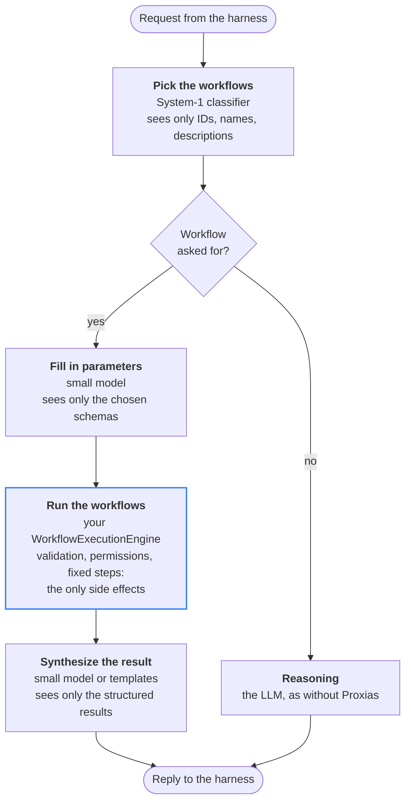

<div align="center">


# Proxias

[](https://github.com/Morebec/proxias/actions/workflows/ci.yml)
[](https://pkg.go.dev/github.com/morebec/proxias)

[](LICENSE)

⚡ An AI gateway that provides a deterministic execution plane for LLM applications, as an embeddable Go SDK.

[Why](#why) • [Features](#features) • [Getting started](#getting-started) • [How it works](#how-it-works) • [Trade-offs](#trade-offs) • [Usage](#usage) • [Adapters](#adapters) • [Middleware](#middleware)

</div>

Proxias sits between a harness and its LLM. It speaks the OpenAI chat completions API, recognizes the requests that your own code can answer, runs that code directly, and asks the model only to put the result into words. Everything else goes to the LLM, as it would without Proxias.

**The model selects and fills in a workflow; it never orchestrates one.**

## Why

The usual agent is a ReAct loop: the harness calls the model, runs the tool it asks for, appends the output, and calls it again, until it answers. Take *"Create an invoice for Acme for March's work"*:

1. the model asks for `find_customer("Acme")`, and the harness runs it;
2. the model reads the customer and asks for `create_invoice(...)`, and the harness runs it;
3. the model reads the confirmation and writes the reply.

That is three calls, each larger than the last, and on every run the model decides the steps and their arguments again. For repeatable business processes, the loop costs more and varies more than the work needs:

- **Cost grows with history.** The API is stateless: every call re-sends the conversation, the tool definitions and every earlier output. Caching makes the repeated prefix cheaper, but the context still grows.
- **Paths vary.** The same request can take another sequence, other arguments, or another number of calls.
- **Valid tools get misused.** Invented tools are rare; wrong parameters, wrong order, actions beyond what the user meant, and prompt injection through tool outputs are not.
- **Hard to audit and test.** Reasoning, selection and execution are interleaved across calls, with no fixed set of paths to regression-test.

With Proxias, the same request goes like this:

1. a fast **System-1** step picks `billing.create_invoice` from the workflows' names and descriptions;
2. a small model fills in the customer and the period, seeing only that workflow's schema;
3. your engine validates them and runs the fixed steps: find the customer, create the invoice, send it;
4. a small model puts the result into words.



Only the engine changes anything; every other step is one narrow decision. What that buys:

- **Fewer tokens.** Selection sees the catalogue's names and descriptions, extraction one schema, synthesis one result: no growing tool loop. How much is saved depends on your catalogue and traffic, so measure it.
- **Deterministic execution.** The steps are compiled, tested Go: the same inputs give the same side effects.
- **A bounded action space.** The model cannot do anything the workflows do not expose, which also narrows what a prompt injection can reach. Reads are workflows too, under the same controls as writes.
- **One place for control.** Validation, permissions, approvals and audit live in your engine and in middleware, not in a prompt.
- **Debuggable by stage.** The choice, the parameters, the run and the reply are separate, and each can be logged and tested on its own.

The authority to define a process stays with whoever writes the workflow, and the user's choices stay with the user.

## Features

- **Deterministic execution.** A classifier (local rules, a small model) maps a request to registered workflows; Proxias runs them directly. No tool loop, no model choosing what runs.
- **Only what each step needs.** A composite classifier lets the parameter extractor see only the selected workflows' descriptors: fewer tokens, a narrower injection surface, and each step can be a small, cheap model.
- **Single-pass synthesis.** One LLM call turns the raw results into a reply.
- **Transparent fallback.** No workflow matches? The request goes to a `ReasoningEngine`, untouched: images, tool calls, cache breakpoints and streaming included.
- **OpenAI chat completions as the model.** Any harness that speaks it works, and `NewChatCompletionHandler` serves a `ControlPlane` over `net/http`.
- **Composable middleware.** Route models, attach identities, or add your own steps to the chain.
- **Claude and OpenAI-compatible adapters**, built on the official SDKs.
- **Negligible overhead**: about 0.1 µs and no allocation per request for the ControlPlane itself.

## Getting started

```sh
go get github.com/morebec/proxias
```

> [!NOTE]
> Proxias requires Go 1.25 or later. It is a library: transports (HTTP, gRPC, CLI) live in your application, and the only one it ships is the OpenAI chat completions endpoint as an `http.Handler`.

A runnable hello world is in [examples/basic](examples/basic): one workflow that answers without any LLM, and Claude as the reasoning engine for the rest.

```sh
export ANTHROPIC_API_KEY=...
go run ./examples/basic
```

## How it works

```text
ChatCompletionRequest
      │
      ▼
1. WorkflowDescriptors()     the workflows: ID, name, description, input schema
      │
      ├─ none ──────────────────────────────────────────────┐
      ▼                                                     │
2. Classify()                which workflows, if any, and their parameters
      │                                                     │
      ├─ reasoning intent (none) ───────────────────────────┤
      ▼                                                     ▼
3. ExecuteWorkflows()                              5. Reason()
      │                                                     │
      ▼                                                     ▼
4. Synthesize()  ─▶  ChatCompletionResponse        ChatCompletionResponse
```

A `ControlPlane` is a chain of middleware; the first step that answers bypasses the rest. The usual chain has two steps:

1. **Workflow interception** (`NewWorkflowInterceptionMiddleware`). Lists the workflows, classifies the request into an `Intent`, runs every workflow it names in one call, and synthesizes the reply. Without a workflow, it passes the request on, with the descriptors in the context.
2. **Reasoning** (`NewReasoningMiddleware`, always last). The `ReasoningEngine` answers, knowing which workflows the application has.

### The four interfaces

| Interface | Role | Typically implemented with |
|---|---|---|
| `IntentClassifier` | Which workflows a request asks for, and their parameters (`Intent`) | rules, a local model, a classification service |
| `WorkflowExecutionEngine` | Describes the workflows and runs the ones an `Intent` names | your workflow registry, a job queue |
| `WorkflowExecutionSynthesizer` | The reply to a request that ran workflows | one LLM call, or templates |
| `ReasoningEngine` | The reply when no workflow fits | the LLM, as without Proxias |

`IntentClassifierFunc`, `WorkflowExecutionSynthesizerFunc` and `ReasoningEngineFunc` turn a function into one. `NewCompositeIntentClassifier(selector, extractor)` splits classification into two stages: a `WorkflowExecutionIntentSelector` names the workflows, then a `WorkflowExecutionIntentParameterExtractor`, given only those workflows' descriptors, reads their parameters.

An `Intent` with no workflow is a **reasoning intent** (`IsReasoningIntent`): nothing runs, and the request goes to the reasoning engine. One request can ask for several workflows (*"restart api and tell me the version"*).

> [!TIP]
> A workflow that cannot run for a reason the user should hear of (a missing parameter, an invalid input) is not an error: return a result whose `Status` says so, with the reason in `Data`, and the synthesizer explains it. Errors are for failures of the system, and are returned wrapped with their stage, so `errors.Is` finds the cause.

The engine is yours, so anything can run behind it: plain Go, a job queue, RPA tools, or MCP servers, which then become a controlled backend instead of an open action space. A long-running workflow can return a task ID, and checking on it is another workflow.

## Trade-offs

Proxias trades flexibility for reliability, and it moves some risks rather than removing them:

- **Workflows come first.** A process must be mapped, written and given a schema before an agent can use it, and that takes domain knowledge.
- **Open-ended requests bypass it.** Brainstorming and the like go to the reasoning engine. Give that lane no tools, or read-only ones.
- **The classifier can be wrong.** It can pick the wrong workflow or miss the right one. Evaluate it on labeled examples, and prefer the reasoning intent (or a clarifying question) when unsure.
- **Parameters can be plausible but wrong.** Validate them in the engine, confirm high-impact actions, and require approval for risky ones.
- **Prompt injection is narrowed, not gone.** User text and workflow results are still untrusted input to the models that read them.
- **Follow-ups need defined behavior.** *"Do the same for March"* is classified with the conversation it comes in; decide what your workflows do with it.
- **Several models per request.** Each is small, but their latency adds up.
- **A synthesizer can misstate a result.** Use templates for the figures that matter (`WorkflowExecutionSynthesizerFunc`) rather than letting a model paraphrase them.

## Usage

### Serving the chat completions endpoint

```go
interception, err := proxias.NewWorkflowInterceptionMiddleware(
	proxias.NewCompositeIntentClassifier(selector, extractor),
	workflows,   // your WorkflowExecutionEngine
	synthesizer, // e.g. anthropic.NewWorkflowExecutionSynthesizer(client, model)
)
if err != nil {
	return err
}
reasoning, err := proxias.NewReasoningMiddleware(reasoner) // forwards what no workflow fits to the LLM
if err != nil {
	return err
}
controlPlane, err := proxias.NewControlPlane(interception, reasoning)
if err != nil {
	return err
}

http.Handle("/v1/chat/completions", proxias.NewChatCompletionHandler(controlPlane))
```

The handler answers 400 for a body that is not a chat completions request (413 if too large), and 502 when the control plane fails. Response bodies are flushed as they are read, so streams reach the client as they are produced. To write your own handler, use `DecodeChatCompletionRequest` and `WriteChatCompletionResponse`.

> [!IMPORTANT]
> The handler does not say why it failed, and Proxias never logs. Log errors yourself with a middleware, and never log a request's messages or headers: they carry user data and credentials.

### Embedding in an application

No HTTP is needed: call `Process` with a request, for instance an admin command typed in a chat box or transcribed from speech.

```go
response, err := controlPlane.Process(ctx, proxias.ChatCompletionRequest{
	Messages: []proxias.ChatMessage{{
		Role:    proxias.ChatMessageRoleUser,
		Content: proxias.ChatContent{{Type: proxias.ChatContentPartTypeText, Text: transcript}},
	}},
})
```

A workflow's reply is built with `NewChatCompletionBuilder(req).BuildText(...)` (or `.BuildToolCalls(...)`) and wrapped by `NewChatCompletionResponse(req, completion)`, which streams it if the request asked for a stream.

## Adapters

Each adapter implements the components (classifier, selector, parameter extractor, synthesizer, reasoning engine) through the provider's official SDK. You build the client, so the key, base URL, timeout and retries are yours, and so is the model.

Proxias is a gateway, as transparent as it can be: a reasoning engine answers a provider's error with a response, the provider's status and headers included (Claude's error is put in the chat completions' shape), and only a call that got no response at all is an error. The other components return the SDK's error, wrapped, for `errors.As`.

### Anthropic

[`adapters/anthropic`](adapters/anthropic) uses the [Anthropic SDK](https://github.com/anthropics/anthropic-sdk-go). Its `ReasoningEngine` maps chat completions to Claude's Messages API and back, so a harness keeps working: text and images, tool calls and results, tools, cache breakpoints (`cache_control`), stop sequences, token limits and streaming.

```go
client := anthropicsdk.NewClient(option.WithAPIKey(key))
classifier := anthropic.NewIntentClassifier(client, anthropicsdk.ModelClaudeHaiku4_5)
reasoner := anthropic.NewReasoningEngine(client, anthropicsdk.ModelClaudeSonnet4_5)
```

> [!NOTE]
> Claude's thinking is not returned: chat completions have no place for it.

### OpenAI-compatible

[`adapters/openai`](adapters/openai) uses the [OpenAI SDK](https://github.com/openai/openai-go) and works with any provider that speaks the chat completions API: OpenAI, OpenRouter, Groq, vLLM, Ollama... Since that API is Proxias's own model, nothing is mapped: the request is forwarded as the harness sent it, unknown fields included, and the answer comes back as it was sent, streams included.

```go
client := openaisdk.NewClient(option.WithAPIKey(key), option.WithBaseURL("https://openrouter.ai/api/v1"))
classifier := openai.NewIntentClassifier(client, "openai/gpt-5-mini")
reasoner := openai.NewReasoningEngine(client, "openai/gpt-5")
```

> [!TIP]
> Use the Anthropic adapter for Claude: its Messages API has the cache breakpoints that the OpenAI-compatible one does not.

## Middleware

`proxias.Middleware` receives the rest of the chain as `next` and returns its own step. A step can:

- **answer**, as the reasoning middleware does;
- **pass on** a changed request, for instance to route the model: `req.Model = chooseModel(req); return next(ctx, req)`;
- **add to the context** what the rest needs, as the interception middleware does with `WithWorkflowDescriptors` / `WorkflowDescriptorsFrom`.

Because the chain sits outside the harness, it is one place for what every request should go through, whatever the harness: stripping personal data before it reaches a model, authorization and injection screening, model selection and provider fallback, context compaction, telemetry. Proxias ships the chain, not these steps.

> [!WARNING]
> A request is passed by value, but its slices and maps are shared with the caller. Replace them, never edit them in place: `req.Messages = append([]proxias.ChatMessage{system}, req.Messages...)`.

### Identity

`NewUserIdentityMiddleware` and `NewAgentIdentityMiddleware` ask an `IdentityProvider` who a request is from and put it in the context, read with `UserIdentityFrom(ctx)` and `AgentIdentityFrom(ctx)`. `NewUserHeaderIdentityProvider` and `NewAgentHeaderIdentityProvider` read a header (an empty name means the OpenAI one, `OpenAI-Organization` or `User-Agent`); `IdentityProviderFunc` takes any function, and `NewIdentityMiddleware[T]` carries an identity type of your own.

```go
user, _ := proxias.NewUserIdentityMiddleware(proxias.NewUserHeaderIdentityProvider("X-User-Id"))
controlPlane, _ := proxias.NewControlPlane(user, interception, reasoning)
```

> [!CAUTION]
> Header providers trust the header as sent. Use them behind a gateway that sets it.

## Trying it with a real harness

[examples/sandbox](examples/sandbox) serves a `ControlPlane` as the chat completions endpoint, with one workflow and Claude for every LLM step (it needs `ANTHROPIC_API_KEY`). [OpenClaw](https://github.com/openclaw/openclaw) runs against it in a Docker container, so nothing else needs installing. To try a middleware, change `buildControlPlane` and restart.

```sh
task sandbox                                 # the sandbox, on :8787 (SANDBOX_PORT=... to change it)
task sandbox:openclaw                        # OpenClaw in a container, configured to use the sandbox
task sandbox:openclaw:agent -- "say hello"   # send it a message, through its gateway
task sandbox:openclaw:dashboard              # the link to its Control UI, token included
```

OpenClaw starts from a fresh state in `.sandbox/openclaw`, so it never touches your own setup. Its gateway listens on `127.0.0.1:18789` only, with the fixed token `proxias-sandbox`.

## Performance

`task bench` measures the ControlPlane's own overhead with fakes that answer instantly: about 0.1 µs and no allocation per request. The time that counts is your classifier's: keep it local and it adds milliseconds at most, well under the 50 ms a request should take before the LLM is reached.

